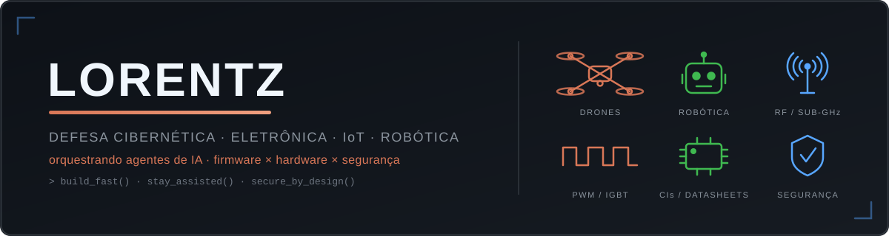
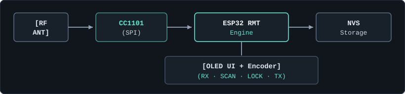

---

## 📄 1. VISÃO GERAL DO SISTEMA *(OVERVIEW)*

Atuação na fronteira entre **Defesa Cibernética**, **Eletrônica de Potência** e **Sistemas Embarcados**. Foco no uso de **orquestração de IA (MCP)** para acelerar a engenharia com validação crítica e segurança desde o design.

> *A IA acelera a execução; o domínio do hardware e da engenharia garante que o sistema esteja certo, não apenas pronto.*

---

## ⚙️ 2. ESPECIFICAÇÕES TÉCNICAS *(CAPABILITIES)*

| Domínio | Pilares | Stack | Aplicação prática |
| :--- | :--- | :--- | :--- |
| **RF & Segurança** | `Sub-GHz` | `CC1101, OOK/ASK, RMT, Shell` | Auditoria de espectro, análise de replay vs rolling-code, recon |
| **Embarcados & IoT** | `ESP32` | `Arduino, SPI, I²C, NVS, GPIO` | Aquisição de sinais, telemetria, drones e embarcados |
| **Eletrônica & Potência** | `PWM` | `IGBTs, MOSFETs, drivers, osciloscópio` | Acionamento e chaveamento de circuitos de potência, leitura de datasheets |
| **Linguagens Core** | `C` | `C++, C#, Bash` | Baixo nível, gestão de memória, firmware e ferramentas desktop |
| **IA & Automação** | `MCP` | `Agent Workflows, Git` | Orquestração de agentes, desenvolvimento assistido e revisão crítica |

---

## 🔬 3. HARDWARE & SEGURANÇA EM DESTAQUE *(BENCHMARK)*

### 📡 [`lorentzesp`](https://github.com/lorentz1/lorentzesp) — Sub-GHz RF Cyberdeck

Ferramenta de **auditoria de RF sub-GHz** sobre **ESP32 + CC1101** para testar a resistência de sistemas de controle (portões, controles e alarmes) a ataques de **replay**, com arquitetura modular em domínios (`radio` · `signal` · `storage` · `ui`).

 CC1101 (SPI) -> ESP32 RMT Engine -> NVS Storage e OLED UI + Encoder" width="85%" />

- **Varredura & RSSI:** monitoramento de espectro (315 / 433 / 868 / 915 MHz) e detecção por limiar
- **Captura & Replay OOK:** aquisição e retransmissão via hardware **RMT** com persistência versionada em **NVS**
- **Interface Cyberdeck:** display OLED (`SSD1306/U8g2`) + encoder incremental nos estados `RX · SCAN · LOCK · TX`

#### 📂 Outros repositórios de segurança

| Repositório | Linguagem | Descrição |
| :--- | :--- | :--- |
| [`multipleScanner`](https://github.com/lorentz1/multipleScanner) | `Shell` | Scanner de listas de domínios e subdomínios para recon |
| [`Basic-Xoring`](https://github.com/lorentz1/Basic-Xoring) | `C` | Cifra e decifra XOR de chave única em baixo nível |

---

 

⚠️ *Uso exclusivo para pesquisa, auditoria autorizada e educação em segurança.*

